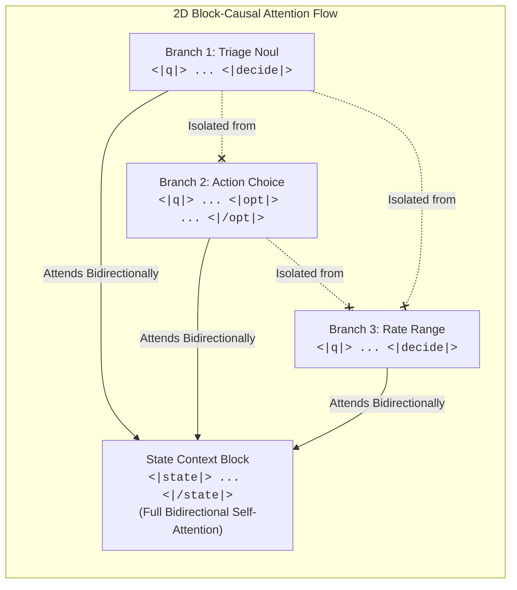
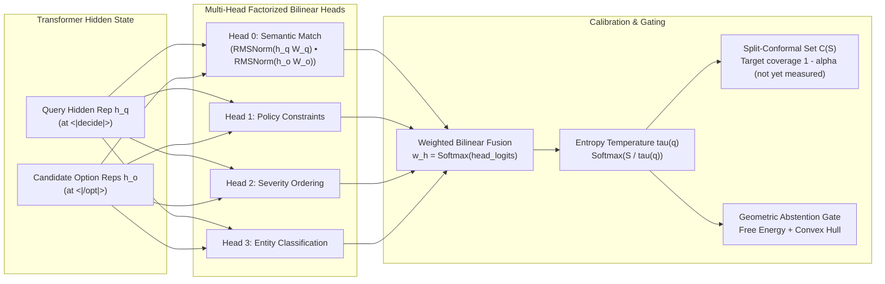

# RHEN: Non-Autoregressive JEV-Type Decision Engine for Agentic AI

[](https://github.com/Kivitas/RHEN/actions/workflows/ci.yml)
[](https://www.python.org/downloads/)
[](https://pytorch.org/)
[](LICENSE)
[](CODE_OF_CONDUCT.md)
[](https://arxiv.org/abs/2609.30266)
[](https://arxiv.org/abs/2609.29327)
[](https://arxiv.org/abs/2609.28879)

**RHEN** is a non-autoregressive **JEV-type (Joint Evaluation)** decision engine for Autonomous Agents and Tool Orchestration. It is alpha-quality research code, not validated for production or safety-critical use; see [Known limitations](#known-limitations).

Traditional agentic architectures rely on autoregressive Large Language Models (LLMs) generating token-by-token JSON strings. This approach suffers from quadratic context latency, uncalibrated hallucinated confidence, parser breakage, and vulnerability to prompt injection. **RHEN eliminates token generation for decisions**: it packs the entire environment state alongside multiple typed decision branches into a single sequence, evaluates all decisions simultaneously in a **single forward pass**, and implements statistical and cryptographic safety mechanisms. What is measured and what is not is listed under [Known limitations](#known-limitations).

### 3-Line Quickstart

```python
from rhen import RhenEngine

engine = RhenEngine()
result = engine.choice("Cluster node cpu=99%, disk=full", "Action", ["Throttle", "Restart", "Ignore"])
print(f"Action: {result.choice_label} (Confidence: {result.confidence:.2%}, Abstained: {result.should_abstain})")
```

---

## Table of Contents

- [Why RHEN? Monolithic LLMs vs. JEV/RHEN](#why-rhen-monolithic-llms-vs-jevrhen)
- [The 7 Typed Semantic Primitives](#the-7-typed-semantic-primitives)
  - [1. Noul (Binary Semantic Truth)](#1-noul-binary-semantic-truth)
  - [2. Choice (Categorical 1-of-K Selection)](#2-choice-categorical-1-of-k-selection)
  - [3. Score (Ordered Continuous Spectrum)](#3-score-ordered-continuous-spectrum)
  - [4. MultiChoice (Independent Subset Selection)](#4-multichoice-independent-subset-selection)
  - [5. Range (Bounded Continuous Interval Regression)](#5-range-bounded-continuous-interval-regression)
  - [6. Extract (Non-Autoregressive Span Pointer Extraction)](#6-extract-non-autoregressive-span-pointer-extraction)
  - [7. Cascade (Multi-Stage Workflows)](#7-cascade-multi-stage-workflows)
- [Architecture Overview](#architecture-overview)
  - [2D Block-Causal Sequence Packing](#2d-block-causal-sequence-packing)
  - [Multi-Head Factorized Bilinear Pointer Head](#multi-head-factorized-bilinear-pointer-head)
  - [Question-Adaptive Temperature Calibration](#question-adaptive-temperature-calibration)
- [Two Modes of Operation](#two-modes-of-operation)
  - [Mode 1: Standalone with Native Looped Latent Backbone](#mode-1-standalone-with-native-looped-latent-backbone)
  - [Mode 2: Attached to Any HuggingFace / PyTorch Model](#mode-2-attached-to-any-huggingface--pytorch-model)
- [Statistical Guarantees & Selective Abstention](#statistical-guarantees--selective-abstention)
  - [Split-Conformal Prediction Coverage (1 - alpha)](#split-conformal-prediction-coverage-1---alpha)
  - [Online Adaptive Conformal Risk Control](#online-adaptive-conformal-risk-control)
  - [Helmholtz Free Energy OOD Detection](#helmholtz-free-energy-ood-detection)
  - [Geometric Convex-Hull Selective Gate](#geometric-convex-hull-selective-gate)
- [Cryptographic Safety Fabric](#cryptographic-safety-fabric)
  - [Action Cards & Risk Tiers](#action-cards--risk-tiers)
  - [Dual-Custody Co-Signing & BFT Quorum Consensus](#dual-custody-co-signing--bft-quorum-consensus)
  - [Merkle Action Ledger](#merkle-action-ledger)
  - [Out-of-Band Audit Trail](#out-of-band-audit-trail)
- [Cognitive Extensions](#cognitive-extensions)
  - [RLCD: RL for Calibrated Decisions](#rlcd-rl-for-calibrated-decisions)
  - [Decision Duration Thresholding (TDT)](#decision-duration-thresholding-tdt)
  - [Hierarchical Choice Router (77+ Intents)](#hierarchical-choice-router-77-intents)
  - [OOD Regression Guard & Verification Lattice](#ood-regression-guard--verification-lattice)
- [Predictive layer and forecast-aware decisions](#predictive-layer-and-forecast-aware-decisions)
- [Installation & Quickstart](#installation--quickstart)
- [Agent Framework Integrations](#agent-framework-integrations)
  - [1. LangChain / LangGraph Semantic Router](#1-langchain--langgraph-semantic-router)
  - [2. CrewAI / AutoGen Action Guard](#2-crewai--autogen-action-guard)
  - [3. FastAPI Low-Latency Decision Microservice](#3-fastapi-low-latency-decision-microservice)
- [Serialization & Storage Guide](#serialization--storage-guide)
- [CLI Reference](#cli-reference)
- [Verification & Test Battery](#verification--test-battery)
- [Known limitations](#known-limitations)

---

## Why RHEN? Monolithic LLMs vs. JEV/RHEN

In typical agent systems, an LLM generates text tokens to choose tool parameters:

```
[Agent State] --> [Decode Token 1] --> [Decode Token 2] ... --> [Parse JSON] --> [Execute Tool]
```

This pipeline is inherently fragile: the LLM must invent syntax characters, probabilities are scattered across dozens of token positions, latency scales with generation length, and agents frequently hallucinate invalid action payloads.

RHEN replaces autoregression with **Joint Evaluation (JEV)**:

```
[Agent State || Branch 1: Q + Options || Branch 2: Q + Options] 
                           |
            [Single Forward Pass (O(1) Step)]
                           |
             [Multi-Head Bilinear Pointer Head]
                           |
[Branch 1: Calibrated Choice] + [Branch 2: Interval Range] + [Action Card HMAC]
```

### Architectural Comparison

| Dimension | Monolithic Autoregressive LLM | RHEN JEV Decision Engine |
| :--- | :--- | :--- |
| **Inference Latency** | $O(N)$ sequential autoregressive token steps (200ms - 3000ms+) | **$O(1)$ single forward pass**. Design target: <15ms on GPU, <50ms CPU (not yet benchmarked in this repo; see [Known limitations](#known-limitations)) |
| **Decision Representation** | Free-form text / JSON strings subject to syntax errors | **Typed Semantic Primitives** (`Choice`, `Range`, `Extract`, etc.) |
| **Confidence Calibration** | Uncalibrated token-level softmax; overconfident on hallucinations | Temperature scaling and a Brier term are implemented; calibration is not yet measured on labelled data in this repo. |
| **Statistical Guarantees** | None (heuristic prompting) | Split-conformal and adaptive conformal machinery is implemented and unit-tested on synthetic data; empirical coverage on labelled data is not yet measured. |
| **Out-of-Distribution (OOD)**| Confidently hallucinated answers on unfamiliar distributions | **Helmholtz Free Energy** and **Geometric Convex-Hull Abstention** |
| **Safety & Authorization** | Post-hoc regex or vulnerable prompt guardrails | **Cryptographic HMAC-SHA256 Action Cards**, **Dual-Custody**, & **BFT Consensus** |
| **Auditability** | In-process log files easily deleted by rogue agents (arXiv:2609.30266) | **Out-of-Band Audit Ledger** (records already emitted cannot be rewritten undetected, but a compromised agent can still emit false records; see [Known limitations](#known-limitations)) and **Merkle Tree Inclusion Proofs** (design target: <0.1ms, not yet benchmarked) |
| **Backbone Compatibility** | Locked to proprietary LLM APIs | **Standalone looped core** OR **attached to ANY HuggingFace model** |

---

## The 7 Typed Semantic Primitives

RHEN defines seven formal, differentiable semantic primitives. All seven primitives are evaluated over a shared environment state without generating textual tokens.

```python
from rhen import (
    RhenEngine,
    Noul,
    Choice,
    Score,
    MultiChoice,
    Range,
    Extract,
    Cascade,
)

engine = RhenEngine()
state = "Database cluster db-east-02 CPU 97.8%, disk I/O saturated, lag 1420ms, alerts: HighLag."
```

### 1. Noul (Binary Semantic Truth)
Evaluates whether a proposition is semantically true or false with calibrated probability.

```python
res = engine.noul(state, "Is database replication severely degraded?")
print(f"Decision: {res.decision}, P(True): {res.p_true:.4f}, Confidence: {res.confidence:.4f}")
```

### 2. Choice (Categorical 1-of-K Selection)
Selects exactly one option from $K$ candidate actions with type-safe probability distribution.

```python
options = ["Throttle Read Queries", "Restart Replica Pod", "Failover to DR", "Ignore"]
res = engine.choice(state, "Recommended mitigation action", options)
print(f"Selected: {res.choice_label} (Index: {res.choice_index})")
print(f"Probabilities: {res.probabilities}")
```

### 3. Score (Ordered Continuous Spectrum)
Predicts an ordered rating along an ordinal scale (e.g., severity 1-10 or priority levels).

```python
res = engine.score(state, "Incident severity score", min_score=1.0, max_score=10.0)
print(f"Severity Score: {res.score:.2f}, Level Distribution: {res.level_probabilities}")
```

### 4. MultiChoice (Independent Subset Selection)
Selects zero, one, or multiple applicable items from an option pool based on calibrated thresholds.

```python
policies = ["PageOnCall", "QuarantineHost", "RateLimitIngress", "ArchiveTelemetry"]
res = engine.multichoice(state, "Enforce policies", policies, threshold=0.5)
print(f"Selected Policies: {res.selected_options}")
```

### 5. Range (Bounded Continuous Interval Regression)
Predicts continuous numeric values and uncertainty intervals using an analytically fitted Beta distribution parameterized by $(\alpha, \beta)$.

```python
res = engine.range(state, "Estimated time to recovery (minutes)", min_val=0.0, max_val=180.0)
print(f"Expected: {res.expected_value:.1f} min, 95% Interval: [{res.interval_low:.1f}, {res.interval_high:.1f}]")
```

### 6. Extract (Non-Autoregressive Span Pointer Extraction)
Locates exact verbatim substring spans from the environment state via bilinear start/end boundary pointers.

```python
state_with_contact = "Primary on-call responder: alex.dev@internal.infra. System load 99%."
res = engine.extract(state_with_contact, slot_name="contact_email", query="Incident responder email")
print(f"Extracted Value: '{res.extracted_value}' at span ({res.start_idx}, {res.end_idx})")
```

### 7. Cascade (Multi-Stage Workflows)
Executes complex conditional decision pipelines in structured sequences.

```python
workflow = [
    Noul("Is critical cluster intervention required?"),
    Choice("Action plan", ["Automated Recovery", "Manual Escalation"]),
]
res = engine.cascade(state, stages=workflow)
print(f"Workflow Decisions: {res.decisions}, Confidence: {res.confidence:.4f}")
```

---

## Architecture Overview

```
                                    +-----------------------------------+
                                    |     Environment State S           |
                                    |   (JSON / Logs / Telemetry)       |
                                    +-----------------+-----------------+
                                                      |
                   +----------------------------------+----------------------------------+
                   |                                                                     |
                   v                                                                     v
       +-----------------------+                                             +-----------------------+
       |   Branch 1: Q1 + Opts |                                             |   Branch 2: Q2 + Opts |
       +-----------+-----------+                                             +-----------+-----------+
                   |                                                                     |
                   +----------------------------------+----------------------------------+
                                                      |
                                                      v
                                    +-----------------------------------+
                                    | 2D Block-Causal Sequence Packing  |
                                    | [State || Branch 1 || Branch 2]   |
                                    +-----------------+-----------------+
                                                      |
                                                      v
                                    +-----------------------------------+
                                    |   Transformer Encoder Backbone    |
                                    |  (Looped Latent Core or HF Model) |
                                    +-----------------+-----------------+
                                                      |
                                                      v
                                    +-----------------------------------+
                                    | Multi-Head Bilinear Pointer Head  |
                                    |  - Head 0: Semantic Match         |
                                    |  - Head 1: Policy Constraints     |
                                    |  - Head 2: Severity Ordering      |
                                    |  - Head 3: Entity Classification  |
                                    +-----------------+-----------------+
                                                      |
                             +------------------------+------------------------+
                             |                                                 |
                             v                                                 v
              +------------------------------+                  +------------------------------+
              | Dynamic Temperature Tau(q)   |                  | Geometric Abstention Gate    |
              | Calibrated Decision Output   |                  | Free Energy & Convex Hull    |
              +------------------------------+                  +------------------------------+
```

### 2D Block-Causal Sequence Packing
RHEN packs state and branches into a single token stream using delimiter control tokens:
- `<|state|>` ... `<|state_diff|>`: Delimits raw environment context. Delimiter spoofing in untrusted data is automatically neutralized (`<|` -> `<¦`).
- `<|q|>` ... `<|decide|>`: Delimits decision questions. The representation at `<|decide|>` forms the query vector $h_q$.
- `<|opt|>` ... `<|/opt|>`: Delimits candidate options. Representations at `<|/opt|>` form candidate representations $h_o$.



The **2D Block-Causal Attention Mask** guarantees:
1. Decision branches attend bidirectionally to the shared environment state.
2. Individual branches are isolated from one another (no cross-branch pollution or ordering bias).
3. The state cannot attend to speculative future options.

### Multi-Head Factorized Bilinear Pointer Head
Rather than projecting to a static vocabulary, RHEN uses low-rank factorized bilinear matching across $H=4$ specialized heads:



$$\mathcal{S}_h(q, o_i) = \frac{\left(\text{RMSNorm}(h_q W_{Q,h})\right) \left(\text{RMSNorm}(h_o W_{O,h})\right)^T}{\sqrt{d_{\text{rank}}}}$$

Aggregated alignment score:
$$\mathcal{S}(q, o_i) = \sum_{h=1}^H w_h \cdot \mathcal{S}_h(q, o_i), \quad w = \text{Softmax}(\text{head\_logits})$$

### Question-Adaptive Temperature Calibration
Overconfidence is actively tempered at the question level. RHEN computes an adaptive temperature $\tau(q)$ based on the semantic entropy of the query vector:

$$\tau(q) = \tau_0 \cdot \exp\left(\beta \cdot \text{Entropy}(h_q)\right)$$

$$P(o_i \mid q, S) = \frac{\exp\left(\mathcal{S}(q, o_i) / \tau(q)\right)}{\sum_j \exp\left(\mathcal{S}(q, o_j) / \tau(q)\right)}$$

---

## Two Modes of Operation

### Mode 1: Standalone with Native Looped Latent Backbone
RHEN includes a native, recurrent latent transformer core featuring YaRN rotary embeddings, continuous latent adapters, Modern Hopfield associative trajectory memory, and state-space memory highways.

```python
from rhen import RhenConfig, RhenEngine

config = RhenConfig(
    hidden_size=256,
    intermediate_size=512,
    num_recurrent_layers=2,
    max_recurrent_loops=3,
)
engine = RhenEngine(config=config)
result = engine.choice("CPU at 98%", "Remediation", ["Scale", "Reboot", "Wait"])
```

### Mode 2: Attached to Any HuggingFace / PyTorch Model
You do **not** need to retrain a base model to use RHEN. The `HuggingFaceEncoderAdapter` allows you to mount RHEN's non-autoregressive decision layer directly onto **BERT, RoBERTa, DeBERTa, LLaMA, Mistral, Qwen, Gemma, T5**, or any custom PyTorch encoder:

```python
from transformers import AutoModel, AutoTokenizer
from rhen import HuggingFaceEncoderAdapter

# Load any HuggingFace encoder
hf_encoder = AutoModel.from_pretrained("bert-base-uncased")
hf_tok = AutoTokenizer.from_pretrained("bert-base-uncased")

# Attach RHEN pointer head
adapter = HuggingFaceEncoderAdapter(
    encoder=hf_encoder,
    tokenizer=hf_tok,
    hidden_size=768,
    num_heads=4,
    rank=128,
)

# Single forward-pass decision evaluation
decisions = [
    ("Target service", ["auth-api", "billing-worker", "gateway"]),
    ("Action severity", ["P1-Critical", "P2-Major", "P3-Minor"]),
]
results = adapter.evaluate_rhen("Cluster memory pressure detected", decisions)
print(results[0]["chosen_option"])
```

---

## Statistical Guarantees & Selective Abstention

Autonomous agents operating critical infrastructure cannot afford to guess when uncertain. RHEN provides four layers of statistical and geometric protection.

### Split-Conformal Prediction Coverage ($1 - \alpha$)
RHEN implements finite-sample distribution-free split-conformal prediction, targeting coverage $1 - \alpha$ (e.g., 95%). Split-conformal and adaptive conformal machinery is implemented and unit-tested on synthetic data; empirical coverage on labelled data is not yet measured in this repo:

$$C(S) = \left\{ o_k \in \mathcal{O} : P(o_k \mid S) \ge 1.0 - \hat{q} \right\}$$

Where $\hat{q}$ is calibrated on held-out non-conformity scores:

```python
from rhen import ConformalPredictionEngine

engine = ConformalPredictionEngine(alpha=0.05)  # 95% target coverage
q_hat = engine.calibrate(calibration_scores=[0.05, 0.10, 0.15, 0.22, 0.30])
res = engine.predict_set({"ActionA": 0.94, "ActionB": 0.05, "ActionC": 0.01})
print(f"Prediction Set: {res['prediction_set']}, Singleton: {res['is_singleton']}")
```

### Online Adaptive Conformal Risk Control
When data distributions shift over time (non-stationary environments), the `AdaptiveConformalEngine` applies a Robbins-Monro martingale update step:

$$q_{t+1} = \text{clamp}\left(q_t + \eta \cdot (\text{error}_t - \alpha), 0.0, 1.0\right)$$

Three consecutive coverage misses automatically raise an **Unseen Covariate Drift Alert**.

### Helmholtz Free Energy OOD Detection
Confidence metrics derived purely from softmax outputs are notorious for assigning high confidence to corrupted out-of-distribution inputs. RHEN computes the **Helmholtz Free Energy** over decision logits:

$$E(x; T) = -T \cdot \log \sum_{i=1}^K \exp\left(\frac{s_i}{T}\right)$$

In-distribution inputs exhibit negative or low free energy; off-manifold or adversarial inputs produce large positive energies exceeding the threshold ($E(x) > \tau_{\text{OOD}}$), triggering immediate abstention.

### Geometric Convex-Hull Selective Gate
Confidence thresholding alone fails when an anomalous query vector points in an arbitrary direction in representation space (arXiv:2609.29327). `GeometricAbstentionGate` projects candidate option representations into latent space and measures the **signed Euclidean distance to their convex hull**:

$$\mathcal{H} = \text{Conv}(\{h_{o_1}, h_{o_2}, \dots, h_{o_K}\})$$

```python
from rhen import GeometricAbstentionGate, ANSWER, ABSTAIN, NEED_CLARIFICATION

gate = GeometricAbstentionGate()
verdict = gate.evaluate(
    probabilities=[0.92, 0.05, 0.03],
    free_energy=1.2,
    conformal_set={"set": ["Restart"]},
    option_latents=candidate_vectors,
    query_latent=query_vector,
)

if verdict.decision == ANSWER:
    execute_action()
elif verdict.decision == ABSTAIN:
    log_safety_rejection(verdict.reasons)
elif verdict.decision == NEED_CLARIFICATION:
    prompt_human_operator()
```

---

## Cryptographic Safety Fabric

RHEN provides a zero-trust cryptographic fabric to prevent unauthorized, forged, or rogue agent actions.

### Action Cards & Risk Tiers
Every proposed action is staged as an immutable `ActionCard` categorized into one of four Risk Tiers:
- **Low**: Read-only diagnostics, metric queries. Auto-approved.
- **Medium**: Cache invalidation, pod scaling. Verified via preflight checks.
- **High**: Service restarts, firewall modifications. Requires confidence $\ge 0.95$ and singleton conformal set.
- **Critical**: Database migrations, traffic drainage, credential rotation. Requires **Dual-Custody** and **BFT Quorum**.

Each card is sealed with a canonical **HMAC-SHA256 signature** covering normalized JSON payload fields. Any mutation to the payload immediately invalidates the signature.

### Dual-Custody Co-Signing & BFT Quorum Consensus
Destructive operations cannot be executed by a single agent persona. For `critical` actions:
1. The initiating agent generates and signs the `ActionCard`.
2. A separate registered validator or security auditor co-signs the revision:
   ```python
   engine.request_dual_custody_cosign(card.id, "SecurityOfficer", auditor_secret_key)
   ```
3. In multi-agent clusters, a **Byzantine Fault Tolerant (BFT) Quorum** of independent peer agents must submit cryptographic affirmative ballots before preflight passes.

### Merkle Action Ledger
All staged and executed actions are appended into a domain-separated cryptographic Merkle tree:
- Leaf hash: $\text{SHA256}(0\text{x}00 \parallel \text{JSON}(\text{stage}, \text{card\_id}, \text{risk\_tier}, \text{status}, \text{signature}, \text{timestamp}))$
- Design target: inclusion proofs verify in **under 0.1 milliseconds** ($\approx 10\ \mu\text{s}$). This has not been benchmarked in this repository, and no benchmark script for it is included yet.

### Out-of-Band Audit Trail
Recent research (arXiv:2609.30266) demonstrated that LLM agents rewarded for task success easily delete or rewrite their own execution logs. In RHEN, the `OutOfBandAuditLedger` can stream cryptographically sealed audit records over a dedicated UNIX socket or TCP port (`SocketAuditSink`). The agent holds no sealing key, and the receiver seals each record with its own key. Each entry hash is chained to its predecessor, so a record that has already been emitted to the receiver cannot be altered or removed from the middle of the chain without detection. Sequence gaps against a sequence number the auditor already expects are reported as omissions.

**Limitations.** The receiver authenticates what it received, not whether it is true. A compromised agent can still emit new records with false content, and those records will verify. It can also stop emitting, and a silent stop at the end of the stream is not detectable from the stored records alone. Records that were never emitted, or were rewritten before emission, are outside the guarantee. Local sealing modes (`InProcessAuditSink`, `FileAuditSink`) keep the key in the agent's own process and only detect casual edits and corruption. See [Known limitations](#known-limitations).

---

## Cognitive Extensions

| Component | Purpose | Key Metric / Guarantee |
| :--- | :--- | :--- |
| **RLCDOptimizer** | Reinforcement Learning for Calibrated Decisions | Confident-wrong decisions receive severe quadratic penalties; encourages well-calibrated confidence |
| **DurationThresholdingHead (TDT)** | Decision Duration Thresholding | Dynamically exits recurrent reasoning loops when certainty threshold is met. TDT reduces loop iterations adaptively; the savings figure is not measured in this repo |
| **HierarchicalChoiceRouter** | Coarse-to-fine candidate routing | The hierarchical router narrows the candidate set before scoring. Its accuracy against a flat scorer is not measured in this repo; see `benchmarks/banking77/README.md` for the measured baselines. |
| **OODRegressionGuard** | Held-out distribution regression monitor | Rejects updates that degrade held-out OOD accuracy beyond configured tolerance |
| **EvidenceVerificationLattice** | Verification protocol | Seeded observer, permutation-invariance critic, and controlled baseline verifier |
| **MultilingualDecisionRouter** | Cross-lingual decision transfer | Heuristic router that routes by stopword and script rules across about 13 language tags (de, fr, pt, es, it, nl, en, hi, ja, ko, ru, ar, zh); no accuracy evaluation in the repo |

---

## Predictive layer and forecast-aware decisions

RHEN can condition a decision on a forecast of the future. The pipeline is:

```
historical series ──► Forecaster (naive baseline or TimesFM 3.0) ──► Forecast (median path + quantiles)
                                                                        │
state text + forecast summary ──► RhenEngine.choice ──► probabilities ◄─┘
                                                                        │
                    DecisionPolicy: constraints · utility · confidence · forecast uncertainty · risk tier
                                                                        │
          EXECUTE ─────────────────────────► executor(option, decision)
          NEEDS_APPROVAL ──► approve(id, approver) ──► executor(option, decision)
          ABSTAIN / BLOCKED ──► not executed
                                                                        │
                       FeedbackLedger ◄── realized series: pinball loss, coverage, Brier
```

```python
from rhen import (
    RhenEngine, ForecastAwareDecider, DecisionPolicy, FeedbackLedger,
    NaiveQuantileForecaster,
)

policy = DecisionPolicy(
    utility=lambda option, features: {"restock_now": 1.0, "hold": 0.8}[option],
    constraints=[("within_budget", lambda option, features: features["series"]["demand"]["median_end"] <= 200)],
    min_confidence=0.6,
    max_forecast_uncertainty=0.5,
    approval_required_tiers=("high", "critical"),
)
ledger = FeedbackLedger()
decider = ForecastAwareDecider(RhenEngine(), NaiveQuantileForecaster(), policy=policy, ledger=ledger)

decision = decider.decide(
    state="Warehouse: 40 units on hand, lead time 5 days.",
    question="Should we restock now?",
    options=["restock_now", "hold"],
    series={"demand": weekly_demand},          # list of floats
    horizon=6,
    thresholds={"demand": 165.0},              # P(demand > 165 within horizon) feeds the risk tier
)

if decision.outcome.status.value == "NEEDS_APPROVAL":
    decider.approve(decision.decision_id, approver="ops-lead")
decider.execute(decision, lambda option, d: place_order(option))   # refuses anything not EXECUTE or approved

ledger.record_outcome(decision.decision_id, {"demand": realized_demand})   # later, when outcomes are known
print(ledger.calibration_report())
```

**Components** (module `rhen/forecasting.py` and `rhen/decision_pipeline.py`):

| Component | Purpose |
| :--- | :--- |
| **`Forecast`** | Median path plus nine quantiles (levels 0.1 to 0.9) per step. `interval(0.8)`, `interval(0.5)`, `prob_exceeds(threshold, step)` and `uncertainty()` are computed from the quantile function by linear interpolation. |
| **`NaiveQuantileForecaster`** | Dependency-free random-walk baseline and the default forecaster. Its median is the last value and its bands come from the empirical quantiles of one-step differences, scaled by the square root of the horizon. |
| **`TimesFMForecaster`** | Adapter for Google TimesFM 3.0 through the `timesfm3` package. Requires `pip install "rhen[forecast]"`. See the licence note below. |
| **`ForecastAwareDecider`** | Runs forecast, state augmentation, `RhenEngine.choice`, policy and ledger. `approve` and `execute` are the only paths to an action. |
| **`DecisionPolicy`** | Deterministic gate. Returns `EXECUTE`, `NEEDS_APPROVAL`, `ABSTAIN` or `BLOCKED`, with reasons for each. It never executes anything. |
| **`FeedbackLedger`** | Records decisions and outcomes. Reports pinball loss, interval coverage and Brier score against realized values. Round-trips through JSONL. |
| **Error metrics** | `pinball_loss`, `interval_coverage`, `mase` and `brier_score`. |

**Policy rules**, applied in order: no admissible option gives `BLOCKED`. Constraint predicates block options. Options are then ranked by `P(option) × utility(option, features)`. Confidence below `min_confidence`, forecast uncertainty above `max_forecast_uncertainty`, or the engine's own abstention gives `ABSTAIN`. A risk tier in `approval_required_tiers` gives `NEEDS_APPROVAL`. Otherwise the result is `EXECUTE`. The risk tier comes from `tier_fn` if you supply one, and otherwise from the largest breach probability against `tier_cutoffs` (0.2, 0.5, 0.8 by default).

**TimesFM 3.0 licence.** The TimesFM 3.0 source code is Apache-2.0, but the 3.0 pretrained weights (`google/timesfm-3.0-pytorch`) are released under `timesfm-non-commercial-license-v1.0`. They are restricted to non-commercial, non-production use. RHEN is MIT-licensed. `TimesFMForecaster` therefore raises `ValueError` unless you pass `license_acknowledged=True`, and you should pass it only if your use is non-commercial and non-production. The example needs both `--timesfm` and `--accept-noncommercial-license`. Nothing in RHEN is licensed to override the weights' terms.

**Limits.**
- RHEN's decision scorer has no trained weights in this repository. The pipeline conditions the decision on the forecast and gates actions on forecast risk. It does not show that the forecast improves decision accuracy, and no benchmark is claimed.
- The policy's rules are deterministic and tested. The utility function, constraints and thresholds are yours to set. The default utility is a constant 1.0, which ranks options by engine probability alone.
- The breach probability for a series is the largest per-step probability. This is a lower bound on the probability of breaching at some step, because the joint distribution across steps is not modelled.
- Quantile tails beyond the 0.1 and 0.9 levels are extrapolated, so exceedance probabilities far outside the band are approximate.
- The ledger measures forecast calibration against realized values. It does not measure whether decisions were good.

---

## Installation & Quickstart

### Prerequisites
- Python 3.10, 3.11, 3.12, or 3.13
- PyTorch 2.0+

### Install via pip

```bash
# Clone the standalone RHEN repository
git clone https://github.com/your-org/rhen.git
cd rhen

# Install in editable mode
pip install -e .

# Or install with developer test dependencies
pip install -e ".[dev]"
```

### Try the Examples

RHEN includes five standalone, copy-pasteable examples in `examples/`:

```bash
# 1. Evaluate all 7 typed primitives in a single pass
python examples/01_quickstart_primitives.py

# 2. Cryptographic action cards, dual-custody, and Merkle inclusion proofs
python examples/02_action_cards_and_merkle_audit.py

# 3. Conformal prediction sets, free-energy OOD, and geometric abstention
python examples/03_conformal_and_abstention.py

# 4. Mount RHEN decision heads onto a HuggingFace transformer
python examples/04_huggingface_adapter.py

# 5. Banking77 hierarchical routing, RLCD calibration RL, and TDT loop reduction
python examples/05_hierarchical_and_rlcd.py

# 6. Latency, throughput and schema error rate benchmark (JEV vs. Autoregressive LLM)
python examples/06_latency_and_jev_comparison.py

# 7. Agent framework integrations (LangChain/LangGraph, CrewAI/AutoGen, FastAPI)
python examples/07_agent_framework_integrations.py
```

---

## Agent Framework Integrations

RHEN is designed as a drop-in deterministic decision engine for popular agentic frameworks, replacing brittle prompt-based JSON tool callers with typed, calibrated, non-autoregressive decision layers. Complete executable implementations are provided in [`examples/07_agent_framework_integrations.py`](examples/07_agent_framework_integrations.py).

### 1. LangChain / LangGraph Semantic Router
Use RHEN as a fast conditional edge or router node in LangGraph state graphs. Rather than prompting an LLM to generate JSON specifying the next node, RHEN evaluates candidate routes in a single forward pass:

```python
from rhen import RhenEngine, Choice

engine = RhenEngine()

def rhen_router_node(state: dict) -> dict:
    context = f"Query: {state['query']}\nIntent: {state.get('intent', '')}"
    routes = ["sql_agent", "vector_search", "direct_reply", "human_triage"]
    
    res = engine.choice(context, "Select workflow destination node", routes)
    
    # Conformal abstention fallback: if uncertain, safely route to human triage
    if res.should_abstain or res.confidence < 0.65:
        state["next"] = "human_triage"
    else:
        state["next"] = res.choice_label
    return state
```

### 2. CrewAI / AutoGen Action Guard
In multi-agent systems, agents frequently attempt destructive tool calls without calibrated safety checks. RHEN acts as an in-line **Action Guard**:

```python
from rhen import RhenEngine, ActionStagingEngine

engine = RhenEngine()
staging = ActionStagingEngine(secret_key=b"corp-agent-signing-key")

def gate_agent_tool_call(agent_name: str, tool_name: str, args: dict, risk_tier: str = "medium"):
    state = f"Agent: {agent_name}\nTool: {tool_name}\nArgs: {args}\nTier: {risk_tier}"
    
    # Single pass policy check
    is_safe = engine.noul(state, "Is this tool invocation safe and compliant?")
    
    # Stage cryptographic ActionCard
    card = staging.stage_action(
        decision_result={"p_safe": is_safe.p_true},
        action_type="execute",
        payload={"tool": tool_name, "args": args},
        risk_tier=risk_tier,
        title=f"Tool Gate: {tool_name}",
    )
    
    preflight = staging.preflight_verification(card.id)
    if not preflight["allowed"]:
        raise PermissionError(f"Action {tool_name} blocked by RHEN Action Guard. Requires dual custody.")
    return card
```

### 3. FastAPI Low-Latency Decision Microservice
Deploy RHEN as a dedicated, sub-5ms internal microservice serving agent fleets across your infrastructure:

```python
from fastapi import FastAPI
from pydantic import BaseModel
from rhen import RhenEngine

app = FastAPI(title="RHEN Decision Service")
engine = RhenEngine()

class DecisionRequest(BaseModel):
    state: str
    question: str
    options: list[str]

@app.post("/decide")
def decide(req: DecisionRequest):
    res = engine.choice(state=req.state, question=req.question, options=req.options)
    return {
        "choice": res.choice_label,
        "confidence": res.confidence,
        "probabilities": res.probabilities,
        "abstained": res.should_abstain,
    }
```

---

## Serialization & Storage Guide

All RHEN primitives, result objects, action cards, and audit ledgers natively support zero-loss JSON serialization and deserialization.

### 1. Decision Results Serialization
Every result object (`NoulResult`, `ChoiceResult`, `ScoreResult`, `MultiChoiceResult`, `RangeResult`, `ExtractResult`, `CascadeResult`) implements `.to_dict()` and `.to_json()` methods, as well as classmethod constructors `.from_dict()` and `.from_json()`:

```python
# Serialize to Python dict or JSON string
data = result.to_dict()
json_str = result.to_json()

# Restore typed result object
from rhen import ChoiceResult
restored = ChoiceResult.from_dict(data)
assert restored.choice_label == result.choice_label
assert restored.confidence == result.confidence
```

### 2. ActionCard & Merkle Inclusion Proofs
Action cards carry cryptographic signatures, canonical payload digests, and risk-tier metadata:

```python
from rhen import ActionCard

# Export signed card for transmission / storage
card_dict = card.to_dict()
card_json = card.to_json()

# Reconstruct and verify
restored_card = ActionCard.from_dict(card_dict)
assert restored_card.signature == card.signature
```

### 3. Canonical JSON Hashing
To prevent subtle whitespace or key-ordering tampering across distributed agent boundaries, RHEN uses RFC-8785 canonical JSON formatting (`canonical_payload_json`):

```python
from agent_tools import canonical_payload_json

# Canonical representation guarantees byte-for-byte identical HMAC digest
clean_json = canonical_payload_json({"b": 2, "a": [1, 2, 3]})
# Output: '{"a":[1,2,3],"b":2}'
```

---

## CLI Reference

RHEN provides high-performance command-line utilities for evaluations and production decisions:

### `rhen-decide`
Evaluates decision schemas over state strings or JSON files:

```bash
# Evaluate decision over text
rhen-decide \
  --state "Node srv-04 CPU 99%, Disk saturated" \
  --question "Recommended mitigation" \
  --options "Throttle,Restart,Failover,Ignore" \
  --format pretty

# Evaluate decision schema file with conformal coverage and OOD checks
rhen-decide \
  --state-file telemetry.json \
  --schema-file decisions.json \
  --alpha 0.05 \
  --ood-threshold 4.5 \
  --format json \
  --out results.json
```

### `rhen-eval`
Benchmarks accuracy, calibration error (ECE), and conformal coverage over test suites:

```bash
rhen-eval --dataset benchmark_decisions.jsonl --device cuda:0 --batch-size 32
```

### `rhen-train`
End-to-end multi-task training with Option Permutation Invariance ($L_{\text{perm}}$) and Preference Loss ($L_{\text{DDPO}}$):

```bash
rhen-train --config configs/rhen_base.json --lr 3e-4 --epochs 5
```

---

## Verification & Test Battery

RHEN is backed by a regression and mathematical verification test battery (25 test modules in `tests/`, covering all 13 architectural pillars):

```bash
# Run the master verification battery
python tests/run_tests.py

# Or run with pytest
pytest tests/
```

Key verified properties:
- **Permutation Invariance**: Maximum deviation $|P(\mathcal{O}) - \pi^{-1}(P(\pi(\mathcal{O})))| \le 10^{-5}$ across random candidate orderings.
- **Proof-of-Staging**: Merkle inclusion proof generation and verification is checked for correctness by the test battery. The $< 0.1\ \text{ms}$ per-leaf figure is a design target and is not benchmarked in this repository.
- **Tamper Detection**: Payload modifications or trace omissions trigger immediate cryptographic rejection.
- **Differentiable Backprop**: Multi-task gradients flow seamlessly into both pointer heads and underlying encoder backbones.

---

## Known limitations

- **Not validated for production or safety-critical use.** RHEN is alpha-quality research code. This repository documents no deployment record or safety evaluation.
- **Calibration is not measured.** Temperature scaling, a Brier term and ECE reporting are implemented. No calibration result on labelled data is committed, so the reliability of the output probabilities is unknown.
- **Conformal coverage is not measured.** Split-conformal and adaptive conformal code is unit-tested on synthetic data. Empirical coverage on labelled data, at any stated alpha, is not reported.
- **Router accuracy is not measured against a flat scorer.** The `HierarchicalChoiceRouter` has no committed accuracy comparison with a flat scorer. The measured Banking77 baselines are in `benchmarks/banking77/README.md`.
- **No trained RHEN decision head is committed.** The only RHEN accuracy figure in the Banking77 benchmark comes from an untrained model on 3 examples (0 of 3 correct). It is a pipeline check, not an accuracy estimate.
- **No comparison has been run** against JEV, Kev, Open-Jev, LAYA or Microsoft-Decision-1. Figures that those projects publish are their own and are not reproduced or ranked here.
- **Audit threat model.** The audit ledger does not prove that logged content is true. A compromised agent can emit new records with false content, and they will verify. A silent stop at the end of the stream is not detectable from the stored records alone. Local sealing modes hold the key inside the agent process. See [Out-of-Band Audit Trail](#out-of-band-audit-trail).
- **Benchmark numbers are unreproduced.** The latency and proof-timing figures in this README (<15ms on GPU, <50ms on CPU, <0.1ms for Merkle proofs) are design targets. No committed benchmark output exists yet. `examples/06_latency_and_jev_comparison.py` measures decision latency on your hardware and model, but no script in the repository times Merkle proof verification.
- **Checkpoint loading trusts the file.** `rhen/research/checkpointing.py` loads the RNG state files (`rng_rank*.pt`) with `torch.load(..., weights_only=False)`, which can execute code embedded in a crafted file. Optimizer and model files load with `weights_only=True`. Load checkpoints only from a trusted source.
- **Large flat configuration.** `RhenConfig` (an alias of `EOSConfig` in `rhen/config.py`) takes 128 named keyword parameters, plus `**kwargs`. Check parameter names against the source before use.

---

## Community & Governance

- [Contributing Guide](CONTRIBUTING.md) — instructions on setting up your local environment, running the test battery, and opening PRs.
- [Security Policy](SECURITY.md) — vulnerability reporting procedure for ActionCard signatures and audit ledgers.
- [Changelog](CHANGELOG.md) — version history and release notes.
- [Code of Conduct](CODE_OF_CONDUCT.md) — Contributor Covenant v2.1 standards.
- [Citation](CITATION.cff) — BibTeX and CFF citation details for papers and publications.

---

## License

RHEN is licensed under the [MIT License](LICENSE).

